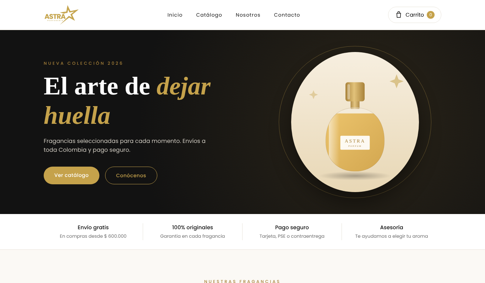
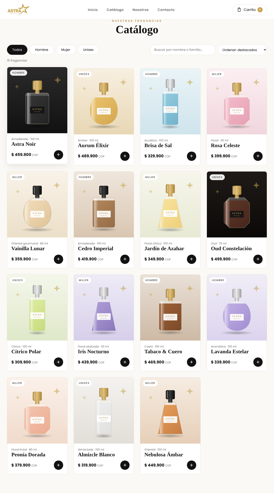
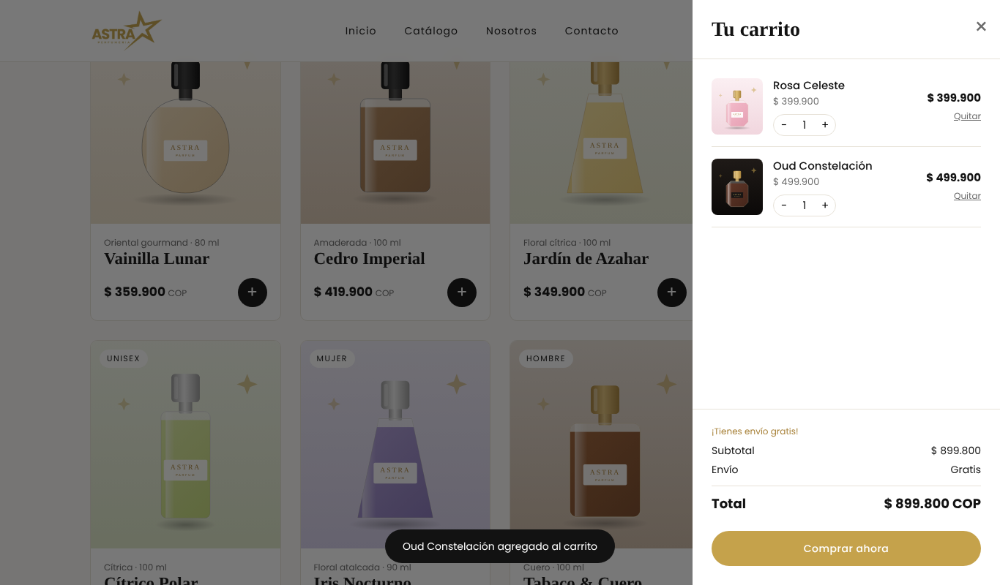
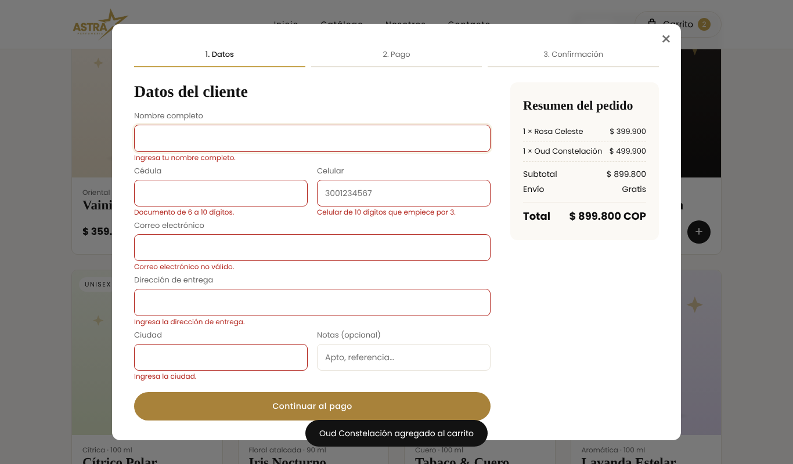
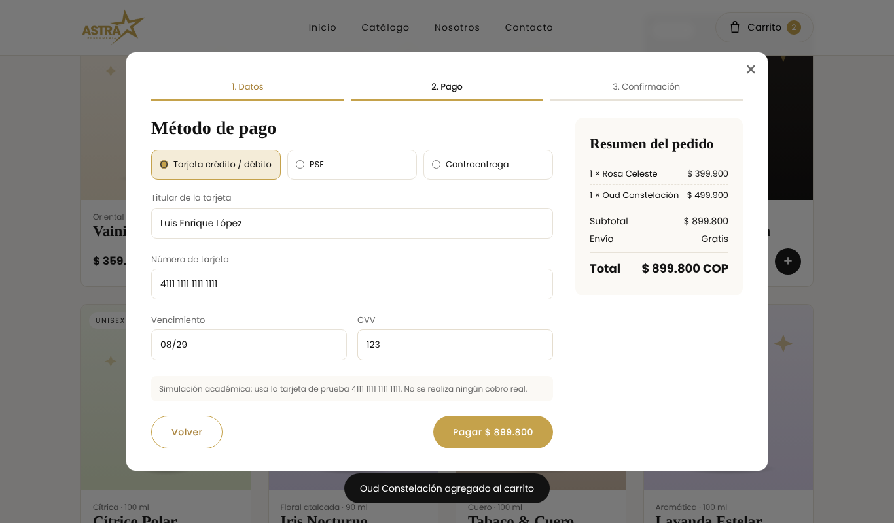
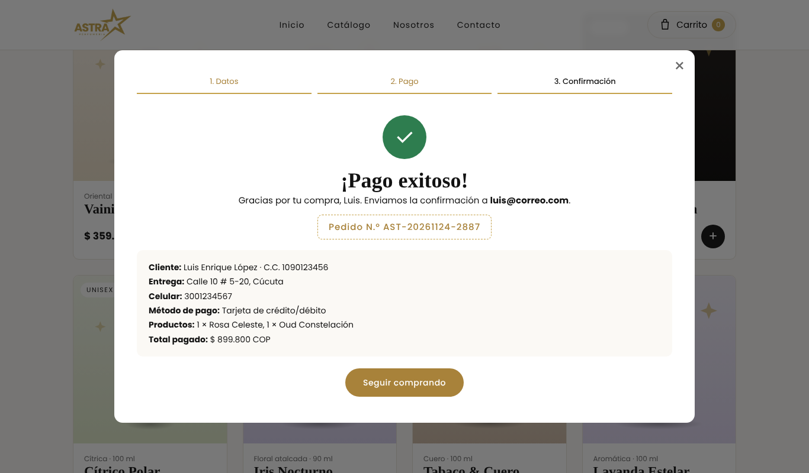

# ✦ Astra Perfumería

Tienda web de escritorio para **Astra Perfumería**. Permite ver el catálogo de fragancias, filtrarlas, agregarlas al carrito, registrar los datos del cliente, pagar (pago simulado) y recibir la confirmación de **pago exitoso**.

> Proyecto académico — Ingeniería de Software, FESC (Fundación de Estudios Superiores Comfanorte).
> El pago es una **simulación**: no se conecta a ninguna pasarela real ni se cobra dinero.



---

## Tabla de contenido
1. [Funcionalidades](#1-funcionalidades)
2. [Tecnologías](#2-tecnologías)
3. [Estructura del proyecto](#3-estructura-del-proyecto)
4. [Arquitectura](#4-arquitectura)
5. [Cómo ejecutar](#5-cómo-ejecutar)
6. [Pruebas unitarias](#6-pruebas-unitarias)
7. [Flujo de compra](#7-flujo-de-compra)
8. [Reglas de negocio](#8-reglas-de-negocio)
9. [Publicar en GitHub y GitHub Pages](#9-publicar-en-github-y-github-pages)
10. [Capturas](#10-capturas)
11. [Autor y licencia](#11-autor-y-licencia)

---

## 1. Funcionalidades

| Módulo | Descripción |
|---|---|
| Catálogo | 15 fragancias con imagen, familia olfativa, tamaño y precio (COP $300.000 – $500.000). |
| Filtros | Por categoría (Todos, Hombre, Mujer, Unisex), búsqueda por nombre o familia y orden por precio o nombre. |
| Detalle | Ventana con descripción, notas olfativas y selector de cantidad. |
| Carrito | Panel lateral: agregar, cambiar cantidad, quitar, subtotal, envío y total. Se guarda en `localStorage`. |
| Datos del cliente | Formulario con validación: nombre, cédula, celular, correo, dirección y ciudad. |
| Pago | Tarjeta (validación Luhn, vencimiento y CVV), PSE (selección de banco) o contraentrega. |
| Confirmación | Pantalla de **pago exitoso** con número de pedido, datos del cliente y total pagado. |

## 2. Tecnologías

- **HTML5**: estructura semántica.
- **CSS3**: diseño de escritorio con Grid, Flexbox, variables CSS y animaciones.
- **JavaScript (ES6+)**: lógica sin frameworks ni librerías externas.
- **Node.js (`node:test`)**: pruebas unitarias sin dependencias.
- **Git / GitHub**: control de versiones y publicación con GitHub Pages.

## 3. Estructura del proyecto

```
astra-perfumeria/
├── index.html              # Página principal (vista)
├── css/
│   └── styles.css          # Estilos (paleta negro / marfil / dorado)
├── js/
│   ├── productos.js        # Capa de datos: catálogo de 15 fragancias
│   ├── logica.js           # Capa de lógica de negocio (funciones puras)
│   └── app.js              # Capa de presentación: DOM y eventos
├── img/
│   ├── logo.jpg            # Logo de Astra Perfumería
│   └── productos/          # Imágenes de los 15 productos (SVG)
├── tests/
│   └── logica.test.js      # 24 pruebas unitarias
├── docs/
│   ├── ARQUITECTURA.md     # Detalle de la arquitectura
│   ├── PRUEBAS.md          # Plan y casos de prueba
│   └── capturas/           # Capturas de pantalla
├── package.json            # Script "npm test"
├── .gitignore
├── LICENSE
└── README.md
```

## 4. Arquitectura

El proyecto usa una **arquitectura por capas** del lado del cliente, inspirada en el patrón **MVC** (Modelo – Vista – Controlador):

```
┌──────────────────────────────────────────────┐
│  VISTA            index.html + styles.css     │  Lo que ve el usuario
└──────────────────────┬───────────────────────┘
                       │ eventos (clic, submit)
┌──────────────────────▼───────────────────────┐
│  CONTROLADOR      js/app.js                   │  Maneja el DOM, el estado
│  (presentación)                                │  y el flujo de compra
└──────────────────────┬───────────────────────┘
                       │ llama funciones puras
┌──────────────────────▼───────────────────────┐
│  LÓGICA DE NEGOCIO  js/logica.js              │  Carrito, totales, filtros,
│                                                │  validaciones, n.º de pedido
└──────────────────────┬───────────────────────┘
                       │ lee
┌──────────────────────▼───────────────────────┐
│  DATOS (MODELO)   js/productos.js             │  Catálogo de productos
│                   localStorage                │  Persistencia del carrito
└──────────────────────────────────────────────┘
```

**Decisiones principales:**

- **Separación de responsabilidades:** `logica.js` no toca el DOM; solo recibe datos y devuelve resultados. Por eso se puede probar en Node.
- **Funciones puras e inmutabilidad:** las funciones del carrito devuelven un arreglo nuevo en lugar de modificar el original, lo que evita errores y facilita las pruebas.
- **Módulos compatibles con navegador y Node:** `productos.js` y `logica.js` se exponen como `window.*` en el navegador y como `module.exports` en Node.
- **Sin backend:** el pago y el envío de correo son simulados. El diseño permite reemplazar la simulación por una API real sin cambiar la lógica.

📄 Más detalle (diagramas de componentes y de secuencia): [`docs/ARQUITECTURA.md`](docs/ARQUITECTURA.md)

## 5. Cómo ejecutar

### Opción A: abrir directamente
1. Descarga o clona el repositorio.
2. Abre `index.html` en Chrome, Edge o Firefox.

### Opción B: con un servidor local (recomendado)
```bash
# Con la extensión "Live Server" de VS Code: clic derecho en index.html → Open with Live Server
# o con Node:
npx serve .
```

> La página está diseñada para **escritorio** (ancho mínimo de 1100 px).

## 6. Pruebas unitarias

Las pruebas unitarias cubren la **capa de lógica de negocio** y la **capa de datos** con el módulo nativo `node:test` de Node.js. No hay que instalar nada.

**Requisito:** Node.js 18 o superior.

```bash
npm test
# o también:
node --test tests/logica.test.js
```

**Resultado esperado:**
```
# tests 24
# pass 24
# fail 0
```

| Grupo | Qué se prueba | N.º |
|---|---|---|
| Catálogo | 15 productos, precios en rango, ids únicos, imágenes | 3 |
| Formato | Precio con separador de miles (`$ 459.900`) | 1 |
| Filtros y orden | Por categoría, por texto, orden ascendente/descendente | 3 |
| Carrito | Agregar, acumular, máximo 10 unidades, inmutabilidad, cambiar cantidad, eliminar, contar | 6 |
| Totales | Envío $15.000, envío gratis desde $600.000, carrito vacío | 3 |
| Cliente | Datos válidos, correo/celular/cédula inválidos, formulario vacío | 3 |
| Pago | Algoritmo de Luhn, vencimiento, tarjeta válida, PSE y contraentrega | 4 |
| Pedido | Formato `AST-AAAAMMDD-NNNN` | 1 |

📄 Casos de prueba detallados (incluye pruebas manuales de la interfaz): [`docs/PRUEBAS.md`](docs/PRUEBAS.md)

## 7. Flujo de compra

1. El cliente navega por el **catálogo** y filtra o busca fragancias.
2. Agrega productos al **carrito** (botón `+` o desde el detalle).
3. Abre el carrito y pulsa **Comprar ahora**.
4. **Paso 1 – Datos:** llena sus datos personales y de entrega (con validación).
5. **Paso 2 – Pago:** elige tarjeta, PSE o contraentrega.
6. Se simula el procesamiento del pago (≈ 2 segundos).
7. **Paso 3 – Confirmación:** aparece **¡Pago exitoso!** con el número de pedido y el carrito se vacía.

**Datos de prueba**

| Campo | Valor |
|---|---|
| Tarjeta | `4111 1111 1111 1111` |
| Vencimiento | Cualquier fecha futura, p. ej. `08/29` |
| CVV | `123` |
| Celular | 10 dígitos que empiecen por 3, p. ej. `3001234567` |

## 8. Reglas de negocio

- Precios en pesos colombianos (COP), IVA incluido.
- Envío: **$15.000**; **gratis** en compras desde **$600.000**.
- Máximo **10 unidades** por producto.
- Cédula de 6 a 10 dígitos; celular colombiano de 10 dígitos que empieza por 3.
- La tarjeta debe pasar el **algoritmo de Luhn** y no estar vencida.

## 9. Publicar en GitHub y GitHub Pages

```bash
git init
git add .
git commit -m "Primera versión: Astra Perfumería"
git branch -M main
git remote add origin https://github.com/TU-USUARIO/astra-perfumeria.git
git push -u origin main
```

Para tener la página en línea: **Settings → Pages → Branch: `main` / `(root)` → Save**.
Queda en `https://TU-USUARIO.github.io/astra-perfumeria/`.

## 10. Capturas

| Catálogo | Carrito |
|---|---|
|  |  |

| Validación de datos | Pago | Pago exitoso |
|---|---|---|
|  |  |  |

## 11. Autor y licencia

- **Autor:** Luis Enrique López Botina — Ingeniería de Software, FESC.
- **Licencia:** [MIT](LICENSE).
- Las imágenes de los productos son ilustraciones propias del proyecto; los nombres de las fragancias son ficticios.
