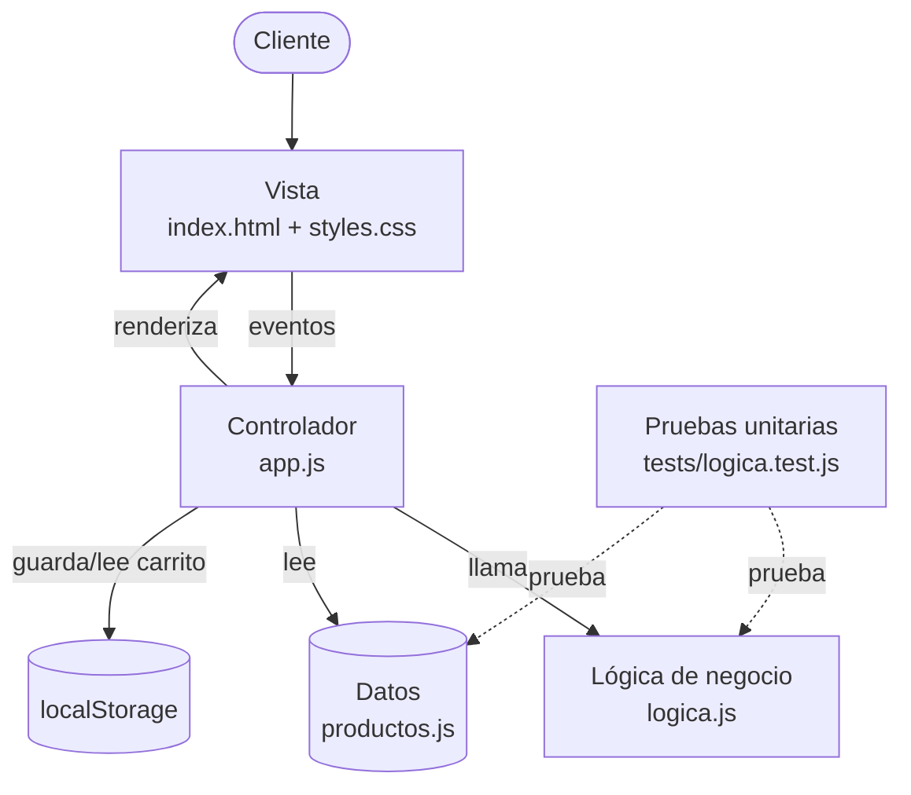
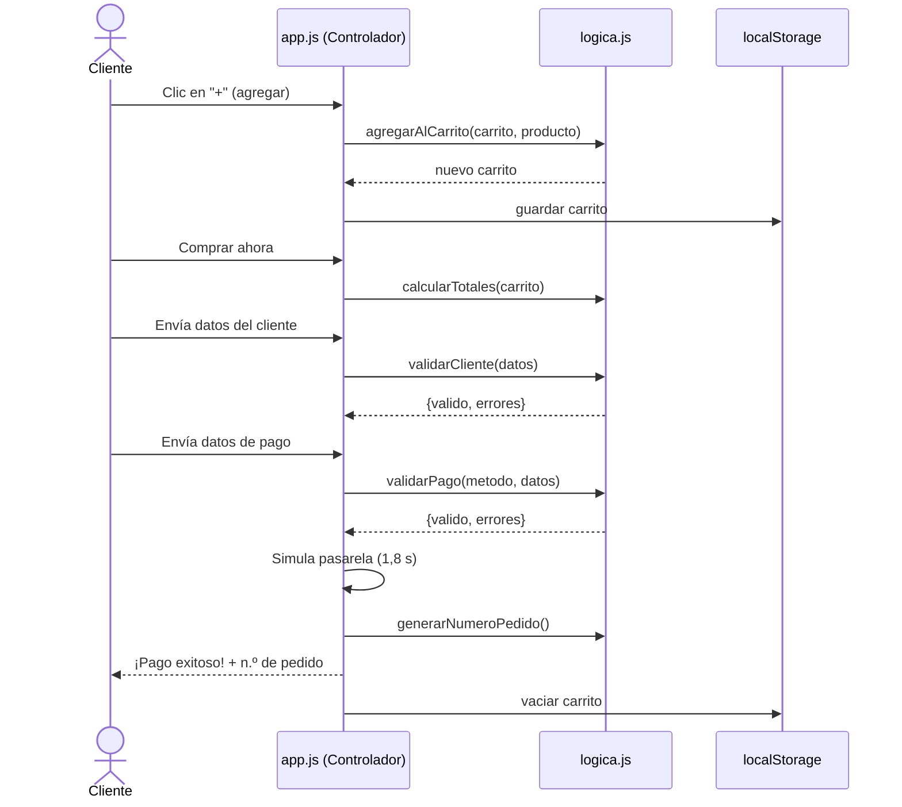

# Arquitectura — Astra Perfumería

## 1. Estilo arquitectónico

Aplicación web **del lado del cliente** (*front-end*), organizada en **capas** según el patrón **MVC**:

| Capa | Archivo | Responsabilidad | ¿Usa el DOM? | ¿Tiene pruebas unitarias? |
|---|---|---|---|---|
| Vista | `index.html`, `css/styles.css` | Estructura y presentación visual | — | Pruebas manuales |
| Controlador | `js/app.js` | Eventos, estado de la UI, renderizado, flujo de checkout | Sí | Pruebas manuales / E2E |
| Lógica de negocio | `js/logica.js` | Reglas: carrito, totales, envío, filtros, validaciones | No | **Sí** |
| Datos (Modelo) | `js/productos.js`, `localStorage` | Catálogo y persistencia del carrito | No | **Sí** |

Regla de dependencia: cada capa solo conoce la capa de abajo. La lógica **nunca** accede al DOM.

## 2. Diagrama de componentes



## 3. Diagrama de secuencia: compra



## 4. Modelo de datos

**Producto**
```js
{ id: 1, nombre: "Astra Noir", categoria: "Hombre", familia: "Amaderada",
  ml: 100, precio: 459900, imagen: "img/productos/astra-noir.svg",
  descripcion: "…", notas: ["Pimienta negra", "Vetiver", "Pachulí"] }
```

**Ítem del carrito**
```js
{ id: 1, nombre: "Astra Noir", precio: 459900, imagen: "…", cantidad: 2 }
```

**Cliente**
```js
{ nombre, documento, correo, telefono, direccion, ciudad, notas }
```

## 5. API de la capa de lógica (`logica.js`)

| Función | Entrada | Salida |
|---|---|---|
| `formatearPrecio(valor)` | número | `"$ 459.900"` |
| `filtrarProductos(lista, categoria, texto)` | arreglo, string, string | arreglo filtrado |
| `ordenarProductos(lista, criterio)` | arreglo, `precio-asc` / `precio-desc` / `nombre` | copia ordenada |
| `agregarAlCarrito(carrito, producto, cant)` | arreglo, objeto, número | nuevo carrito |
| `cambiarCantidad(carrito, id, cant)` | arreglo, número, número | nuevo carrito |
| `eliminarDelCarrito(carrito, id)` | arreglo, número | nuevo carrito |
| `contarUnidades(carrito)` | arreglo | número |
| `calcularTotales(carrito)` | arreglo | `{subtotal, envio, total}` |
| `validarCliente(datos)` | objeto | `{valido, errores}` |
| `validarLuhn(numero)` | string | booleano |
| `validarVencimiento(mmaa, hoy?)` | `"MM/AA"` | booleano |
| `validarPago(metodo, datos, hoy?)` | string, objeto | `{valido, errores}` |
| `generarNumeroPedido(fecha?, aleatorio?)` | Date, número | `"AST-20261124-5298"` |

## 6. Principios aplicados

- **Separación de responsabilidades (SoC)** y **responsabilidad única (SRP)**: cada archivo tiene una sola función.
- **Funciones puras e inmutabilidad**: resultados predecibles y fáciles de probar.
- **Inyección de dependencias simple**: `validarVencimiento` y `generarNumeroPedido` reciben la fecha como parámetro opcional para que las pruebas sean deterministas.
- **Validación en cliente** con mensajes por campo.

## 7. Posible evolución

- Backend (Node/Express o Spring Boot) con base de datos MySQL para productos y pedidos.
- Integración con una pasarela real (Wompi, PayU, Mercado Pago).
- Envío real del correo de confirmación.
- Panel de administración para gestionar el inventario.
